<p align="center"></p>

<h3 align="center">Plan a Marswalk on real NASA terrain — and make it back.</h3>

<p align="center">
  <a href="https://redreturngt.us"><b>▶ Live demo · redreturngt.us</b></a> &nbsp;·&nbsp;
  <a href="https://redreturn-api-113287289372.us-central1.run.app/docs">API docs</a> &nbsp;·&nbsp;
  <a href="docs/DEMO_SCRIPT.md">Demo script</a> &nbsp;·&nbsp;
  <a href="docs/SCIENTIFIC_VALIDATION.md">Scientific validation</a>
</p>

<p align="center">
  
  
  
  <br>
  
  
  
  
  
</p>

---

> **The first people to walk on Mars will not have GPS, a rescue team or a second chance.**
> Every excursion is a trade between how far the crew can go and how sure they are of getting back.
>
> **RedReturn** answers one question: *can this crew reach this science target, survive what might go wrong, and return to base with margin?*
> It uses **real NASA elevation data**, compares four routes, stress-tests them with thousands of what-ifs, breaks the plan on purpose, and hands the crew a field card they can follow.

Built for **NASA Space Apps Challenge 2026 — [Interplanetary Survival Guide: Martian Map](https://www.spaceappschallenge.org/2026/challenges/interplanetary-survival-guide-martian-map/)**.

<p align="center">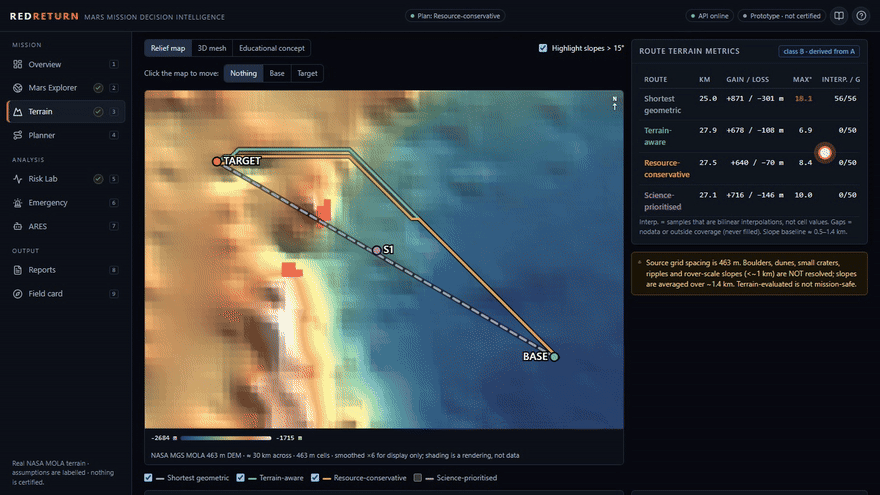</p>

## ✨ Try it in 60 seconds

1. Open **[redreturngt.us](https://redreturngt.us)**. A short guided tour starts on your first visit, and you can replay it with **?**.
2. **Mars Explorer:** click anywhere on Mars to set a **base** and a **target**. The Jezero crater demo is preloaded.
3. **Terrain:** see the routes on real MOLA relief, flip to **3D**, and look for the slopes marked in red.
4. **Planner → Risk Lab:** compare oxygen, energy, daylight and return margin, then run the **Monte Carlo** stress test.
5. **Emergency:** inject a battery loss or slow rover → *"Abort now and return to base"*.
6. **Field card → Visor:** the route as legs with bearing, distance and the oxygen left on arrival.

Every mission lives in the URL, so **Copy mission link** shares exactly what you see.

## 🛰️ The mission, step by step

<table>
<tr>
<td width="50%">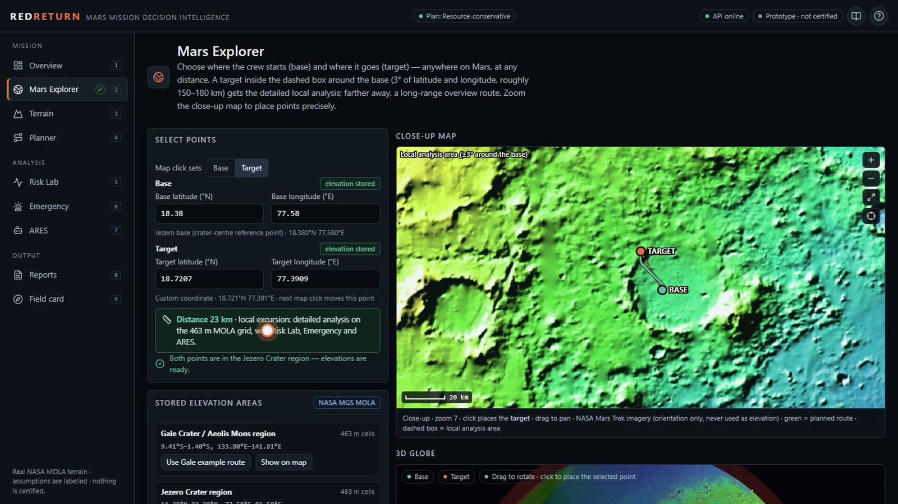<br><b>1 · Choose anywhere on Mars.</b> Close-up NASA Trek map plus a 3D globe. Short trips get the full 463 m analysis; for long journeys the planner switches to an overview route automatically.</td>
<td width="50%">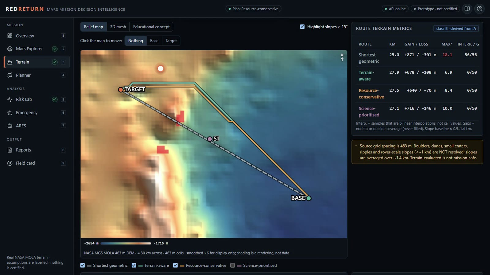<br><b>2 · Read the real terrain.</b> Four routes (shortest, terrain-aware, resource-conservative, science-prioritised) are drawn on <b>measured MOLA elevations</b>, with steep slopes highlighted.</td>
</tr>
<tr>
<td>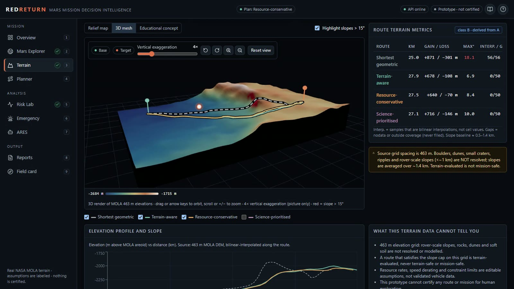<br><b>3 · See it in 3D.</b> A navigable mesh with vertical exaggeration, elevation and slope profiles, and a panel on <i>what this terrain cannot tell you</i>.</td>
<td>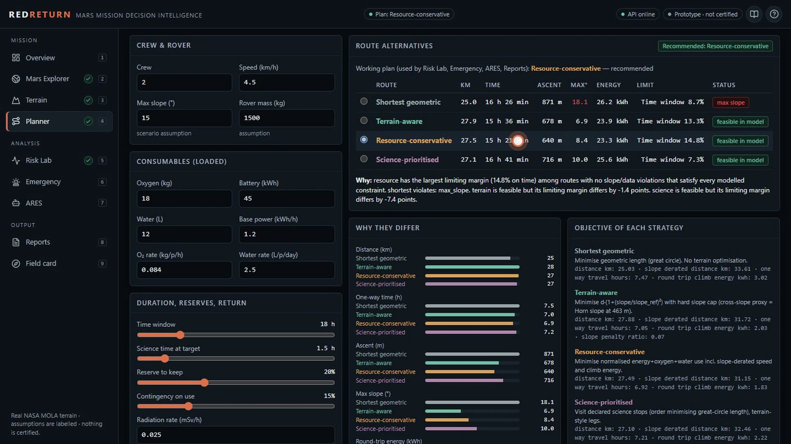<br><b>4 · Plan the crew and supplies.</b> Crew, rover, oxygen, water, energy, reserves and science stops. Every route gets a status and the reason it was recommended.</td>
</tr>
<tr>
<td>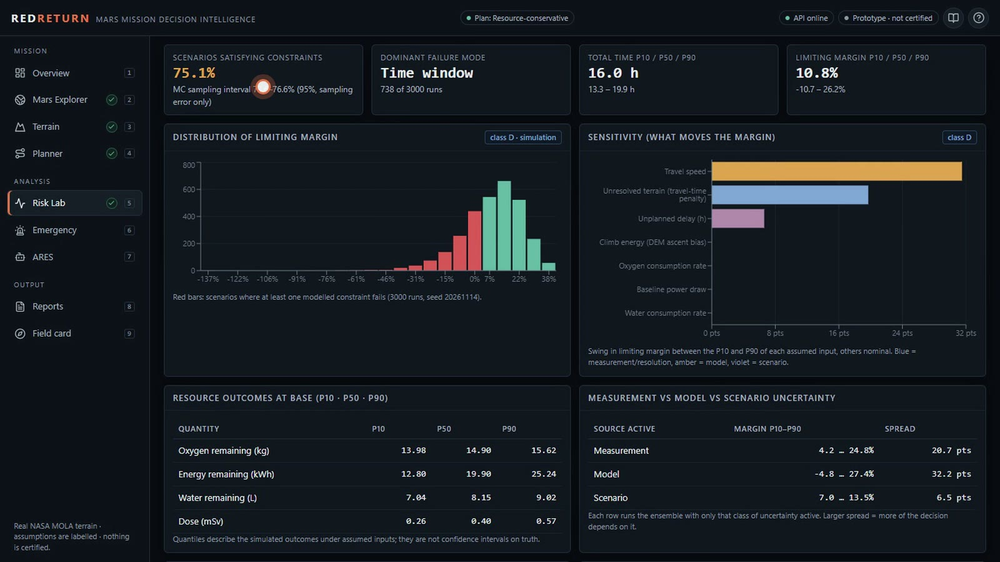<br><b>5 · Stress-test it.</b> Seeded Monte Carlo, P10/P50/P90 margins, the dominant failure mode, and which assumption moves the result most.</td>
<td>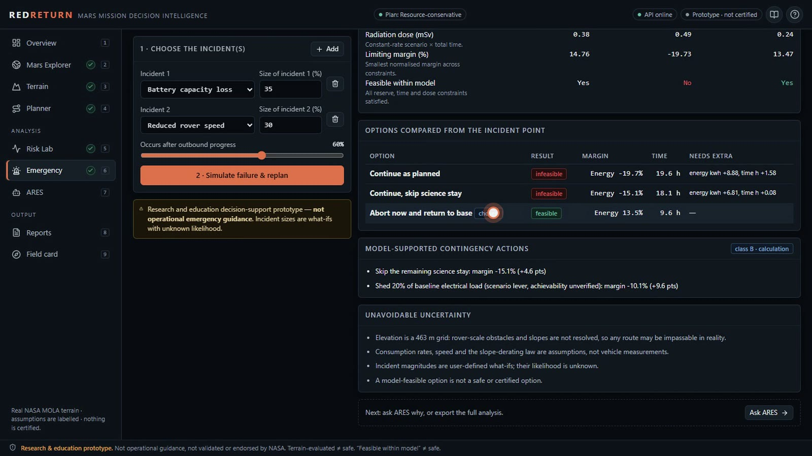<br><b>6 · Break the plan on purpose.</b> Inject incidents and compare the original, failed and revised missions: continue, skip the science stop, or abort and return.</td>
</tr>
<tr>
<td>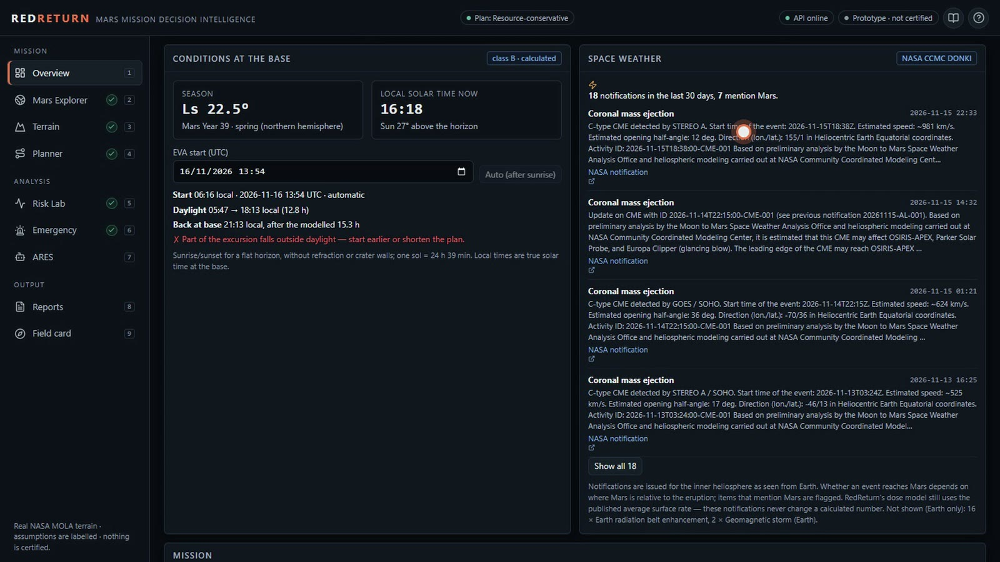<br><b>7 · Know the conditions.</b> Mars season (Ls), local solar time, sunrise and sunset via NASA GISS <b>Mars24</b>, a check that the walk fits in daylight, and live <b>NASA DONKI</b> space-weather alerts.</td>
<td>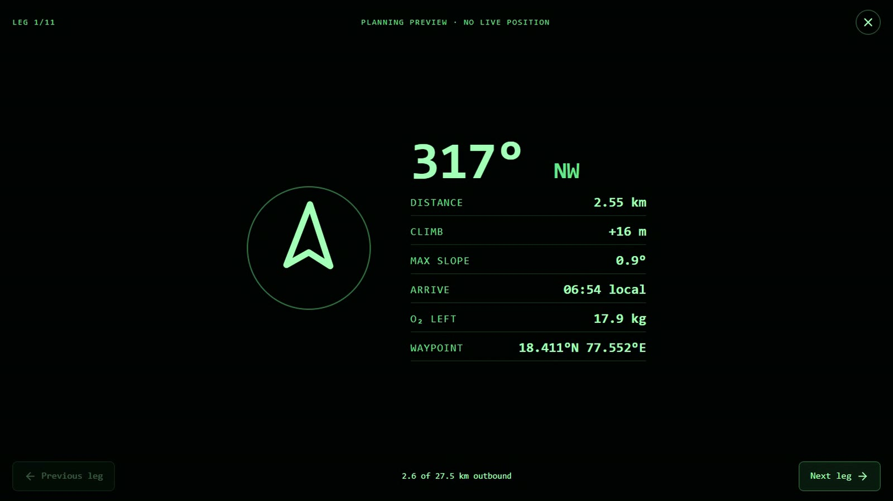<br><b>8 · Take it into the field.</b> Leg-by-leg field card (bearing, climb, arrival time, O₂ left), printable, with a high-contrast <b>Visor mode</b>.</td>
</tr>
</table>

<p align="center">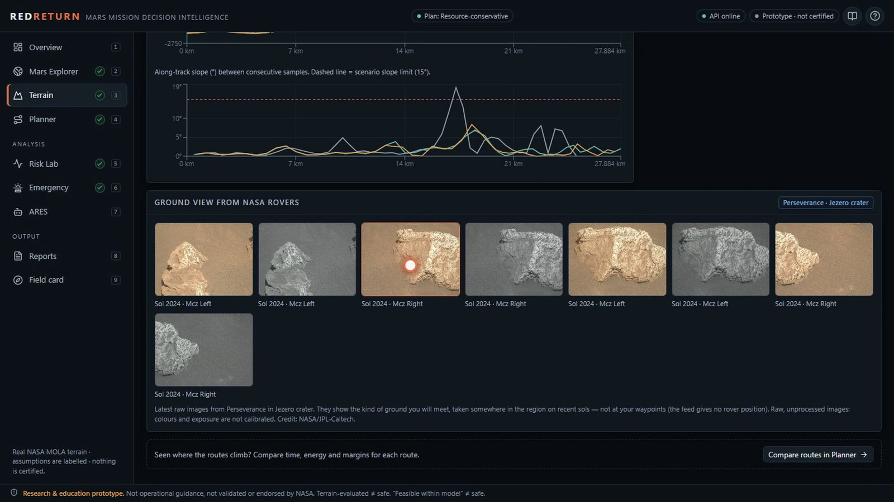<br><sub>Ground view: the latest raw images from <b>Perseverance</b> (Jezero) or <b>Curiosity</b> (Gale), shown as regional context.</sub></p>

## 🏆 Why it matters (judging criteria)

| Criterion | What RedReturn brings |
|---|---|
| **Impact** | It turns open NASA data into the question astronauts will actually ask: *can we get back?* It doubles as a teaching tool for EVA planning, uncertainty and risk. |
| **Creativity** | Instead of drawing a pretty path, it **breaks the plan on purpose** (Emergency), explains *why* (ARES answers from the calculations) and ends in a field-ready **visor**. |
| **Validity** | Real MOLA elevations, published algorithms (Mars24, Horn slope), deterministic seeded maths, reproducibility hashes, and 16 independent recomputation checks. **Nothing is invented and no route is ever called "safe".** |
| **Relevance** | It covers the challenge's points: routes that avoid steep terrain, crew safety, radiation and mobility limits, layered data from several NASA missions, and an interface for the crew. See [CHALLENGE_ALIGNMENT](docs/CHALLENGE_ALIGNMENT.md). |
| **Presentation** | A guided tour, a glossary for every term and plain-language next steps. It works on phones, tablets and desktops (375–1280 px, checked with axe). |

## 🔭 NASA data inside

| Source | Mission or instrument | How it is used |
|---|---|---|
| **MOLA 463 m DEM** (USGS / NASA) | Mars Global Surveyor | **Measured** elevation that drives all calculations. Jezero and Gale are shipped; any other area is downloaded on demand with HTTP range requests |
| **NASA Mars Trek** tiles | MGS, Viking, Mars Odyssey THEMIS, TES | Map and globe imagery, **display only** (never turned into numbers) |
| **Mars24** algorithm (NASA GISS, Allison & McEwen 2000) | — | Season, local solar time, Sun elevation, daylight window |
| **DONKI** (NASA CCMC) | Space-weather notifications | Flares, solar energetic particles (SEP), CMEs; alerts that mention Mars are flagged. Context only |
| **Mars Rover raw images** | Perseverance, Curiosity | Regional ground view near the base |
| **MSL RAD** published dose | Curiosity | Anchors the radiation-rate assumption |

## 🧪 Scientific honesty, built in

Each value is labelled as **measured**, **calculated**, **assumed** or **simulated** (data classes A–E, see [DATA_PROVENANCE](docs/DATA_PROVENANCE.md)). The app enforces these rules:

- Visual imagery is never treated as elevation. Missing data stays missing, and interpolated samples are flagged.
- A 463 m grid **cannot see boulders or hazards smaller than about 1 km**, and the UI says so next to every route.
- Monte Carlo output is **not** a survival probability. "Feasible within the model" does not mean safe, and no route is ever certified.
- Long-range routes are labelled *overview only*: at kilometre spacing, slopes are invisible.
- If the API is offline, the app shows only the Jezero demo, from a clearly labelled precomputed snapshot.

Details: [SCIENTIFIC_VALIDATION](docs/SCIENTIFIC_VALIDATION.md) · [VALIDATION_RESULTS](docs/VALIDATION_RESULTS.md).

## 🧱 Architecture

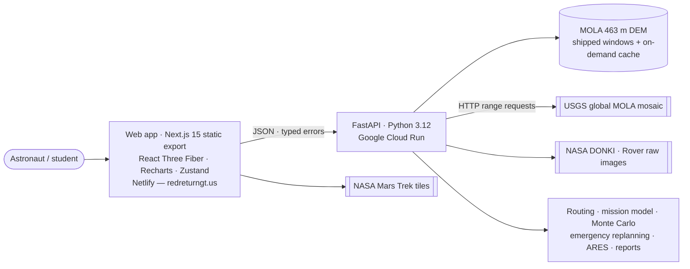

- **Routing:** four objectives on the DEM. Shortest is a great-circle line; terrain-aware and resource-conservative use A* with a hard slope cap; science-prioritised orders the declared stops. Nodata cells are impassable, never filled. Long trips use a coarse grid of exact MOLA samples (every *f*-th cell, never averaged).
- **Reproducible:** seeded Monte Carlo, platform-independent ranks, and SHA-256 request and result hashes in the JSON reports.
- **Exports:** PDF, JSON and GeoJSON reports.

More: [ARCHITECTURE](docs/ARCHITECTURE.md).

## ✅ Quality you can verify

| Suite | Result |
|---|---|
| Vitest (TypeScript, including golden parity with Python) | **80 / 80** |
| Pytest (geodesy, DEM, routing, mission, risk, emergency, API contracts) | **90 / 90** |
| Playwright e2e (user journeys, axe accessibility, 375 / 768 / 1280 px, API-down fallback) | **37 / 37** |
| Live API smoke test (`scripts/smoke_api.py`) | **38 / 38** |
| Independent recomputation of the demo (`scripts/validate_independent.py`) | **16 / 16** |

The risk hash of the demo is the same on the live API and in the site snapshot (`b9ec860e5030b683`). See [VERIFICATION](docs/VERIFICATION.md).

## 🚀 Run it locally

```bash
# API (Python 3.12)
python3.12 -m venv .venv && .venv/bin/pip install -r api/requirements.txt
.venv/bin/python -m uvicorn api.main:app --port 8000      # OpenAPI: http://localhost:8000/docs

# Web (Node 22)
npm ci && npm run dev                                      # http://localhost:3000
```

The checks:

```bash
npm run typecheck && npm test
.venv/bin/python -m pytest api -q
.venv/bin/python scripts/validate_independent.py
npx playwright test
```

Set `NEXT_PUBLIC_API_URL` **before** building to point the site at your API. See `.env.example` for every variable. Setting a free `NASA_API_KEY` (from api.nasa.gov) avoids the shared `DEMO_KEY` rate limit.

<details>
<summary><b>Terrain anywhere on Mars: on-demand MOLA settings</b></summary>

Outside the shipped Jezero and Gale windows, the API reads only the bytes it needs from the global uncompressed int16 MOLA TIFF using HTTP range requests. This takes about 5–60 s, once per area. Values are stored untouched, with a provenance sidecar.

| Variable | Default | Meaning |
|---|---|---|
| `REDRETURN_DEM_ON_DEMAND` | `1` | `0` uses only the shipped windows |
| `REDRETURN_DEM_CACHE_DIR` | `api/data/dem/ondemand` | Where downloaded areas are stored |
| `REDRETURN_DEM_CACHE_MAX` | `40` | Areas kept; the oldest are evicted |
| `REDRETURN_DEM_DOWNLOADS_PER_MIN` | `6` | New-area downloads per minute (HTTP 429 beyond) |
| `REDRETURN_LONG_RANGE_MAX_CELLS` | `80000` | Grid budget for long-range overview routes |

**Local vs long-range:** when base and target are within 3° of latitude and longitude (about 150–180 km), you get the full local analysis. Farther apart, you get a labelled overview route with travel time, sols and supplies as estimates. Risk Lab, Emergency and ARES need a local excursion.

</details>

<details>
<summary><b>API endpoints</b></summary>

`GET /api/health · /api/diagnostics · /api/datasets · /api/datasets/status · /api/terrain/coverage · /api/terrain/elevation · /api/terrain/heightfield · /api/demo · /api/conditions/space-weather · /api/conditions/surface-images`

`POST /api/terrain/profile · /api/routes/alternatives · /api/routes/long-range · /api/risk/analyze · /api/scenarios/simulate · /api/ares/ask · /api/reports/json · /api/reports/geojson`

Every error uses the shape `{"error": {"code", "message", "details"}}`.

</details>

<details>
<summary><b>Deploy</b></summary>

- **Web:** Netlify ([`netlify.toml`](netlify.toml)) or any static host serving `out/`.
- **API:** Google Cloud Run with `.\scripts\deploy_cloud_run.ps1 -ProjectId <project> -WebOrigin https://<site>`. It uses Cloud Build and `api/Dockerfile`, scales to zero, and gets 1 GiB with CPU boost. Railway (`railway.toml`), Render (`render.yaml`) and any Docker host also work.
- **CORS:** set `REDRETURN_CORS_ORIGINS`, plus `REDRETURN_CORS_ORIGIN_REGEX` for preview URLs.

</details>

## ⚠️ Known limitations

- There is no boulder, rock or soil data, and the terrain is at 463 m resolution, not HiRISE or CTX scale.
- Consumption uses a constant-rate resource model.
- The optional LLM paraphrase in ARES is off by default and untested.
- Routes that cross the 180° meridian are planned the long way round.
- The question of pre-existing code is disclosed and still open ([COMPLIANCE](docs/COMPLIANCE.md)).

## 📚 Documentation

[Challenge alignment](docs/CHALLENGE_ALIGNMENT.md) · [Data provenance](docs/DATA_PROVENANCE.md) · [Scientific validation](docs/SCIENTIFIC_VALIDATION.md) · [Architecture](docs/ARCHITECTURE.md) · [Demo script](docs/DEMO_SCRIPT.md) · [Judging evidence](docs/JUDGING_EVIDENCE.md) · [Verification](docs/VERIFICATION.md) · [Validation results](docs/VALIDATION_RESULTS.md) · [Submission pack](docs/SUBMISSION_PACK.md) · [References](docs/REFERENCES.md) · [Final report](docs/FINAL_REPORT.md) · [Compliance](docs/COMPLIANCE.md) · [AI use](docs/SI_USE.md)

## 🤖 AI-assisted development

AI coding assistants helped build this project (Codex for earlier commits, then Claude via Claude Code). The idea, the decisions and the review were the team's. Every number comes from deterministic, tested code. See [SI_USE](docs/SI_USE.md).

## 📄 License and disclaimer

There is no LICENSE file yet (see [COMPLIANCE](docs/COMPLIANCE.md)); the Space Apps default is Apache-2.0.
**RedReturn is a research and education prototype.** It is not operational guidance, does not certify any route, and is not validated or endorsed by NASA. NASA data is used under NASA's media and data guidelines.

<p align="center"><b>RED<span>RETURN</span></b> · Make it back. · <a href="https://redreturngt.us">redreturngt.us</a></p>
