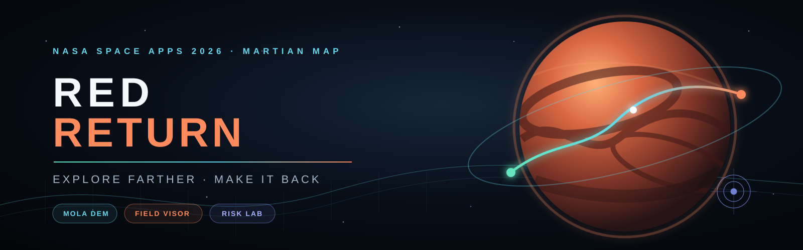

<p align="center"></p>

# RedReturn — Mars mission decision intelligence

> **Can a crew reach a science target on Mars, survive plausible failures, and return with margin?**
> Real NASA MOLA elevation → route alternatives → explainable uncertainty → failure-aware revised mission.

Built for **NASA Space Apps 2026 — [Interplanetary Survival Guide: Martian Map](https://www.spaceappschallenge.org/2026/challenges/interplanetary-survival-guide-martian-map/)**.
Educational research prototype. **Not operational guidance; never certifies a route; not validated or endorsed by NASA.**

## What it does
| Tab | Decision it supports |
|---|---|
| Overview | Is the mission feasible *within the model*, how thin is the return margin, how good is the data? |
| Mars Explorer | Pick base/target on a 3D globe + 2D map synced with NASA Trek layers (MOLA, Viking, THEMIS, TES); see where numeric terrain exists. |
| Terrain | Relief map / 3D mesh from **real MOLA elevations**, elevation + slope profiles, resolution and coverage disclosure. |
| Planner | Crew, rover, consumables, reserves, science stops; four route strategies with different objectives and the reason for the recommendation. |
| Risk Lab | Seeded Monte Carlo (hypothetical inputs), sensitivity, failure modes, P10/P50/P90, measurement-vs-model-vs-scenario uncertainty, "Why this result?". |
| Emergency | Inject battery/speed/oxygen/water/delay/comms/obstruction incidents → ORIGINAL vs FAILURE vs REVISED mission with causes, options and levers. |
| ARES | Questions answered **from the calculations** (provenance badge, tools used, uncertainty). Optional LLM paraphrase is off by default. |
| Reports | PDF, JSON (with reproducibility hashes), GeoJSON; data sources by class A–E; challenge alignment. |

First visit opens a plain-language guided tour (replay with **?**); a **Glossary** explains every term; the Overview shows mission progress step by step. The address bar always holds the current mission (base, target, stops, changed settings) — **Copy mission link** shares or bookmarks it. If the API is unreachable, only the Jezero demo is shown, from a labelled precomputed snapshot.

**Site conditions and field use.** *Conditions at the base* (Overview) computes the season (solar longitude Ls, Mars Year), local true solar time, Sun elevation, sunrise/sunset and whether the planned EVA fits in daylight with NASA GISS's **Mars24** algorithm (Allison & McEwen 2000), and flags the dust-storm season (Ls 180°–360°). *Space weather* lists recent **NASA CCMC DONKI** notifications (flares, solar energetic particles, CMEs, interplanetary shocks; Earth-only alerts are filtered out) and flags those that name Mars — context only, never an input to the dose model. *Ground view* (Terrain) shows the latest raw images from **Perseverance** (Jezero) or **Curiosity** (Gale) when the base is in their region, labelled as regional context, not waypoint photos. The **Field card** tab turns the working route into legs with bearing, distance, climb, local arrival time and oxygen left, prints as a cue card, and has a high-contrast **Visor mode** (heads-up style, planning preview without live position). Set `NASA_API_KEY` on the API (free at api.nasa.gov) to avoid the shared `DEMO_KEY` rate limit; responses are cached 3–6 h.

## Quick start
```bash
# API (Python 3.12)
python3.12 -m venv .venv && .venv/bin/pip install -r api/requirements.txt
.venv/bin/python -m uvicorn api.main:app --port 8000        # docs: http://localhost:8000/docs

# Web (Node 22)
npm ci && npm run build && python3 -m http.server 3000 --directory out   # or: npm run dev
```
Set `NEXT_PUBLIC_API_URL` at build time to your deployed API. Copy `.env.example` for all variables.

## Verify
```bash
npm run typecheck && npm test        # TypeScript, 23 Vitest cases incl. golden parity with Python
.venv/bin/python -m pytest api -q    # 76 cases: geodesy, DEM, routing, mission, risk, emergency, API contracts
.venv/bin/python scripts/validate_independent.py   # 16 independent recomputation checks of the demo
docker compose up -d --build && npx playwright test   # 23 e2e: journeys, axe accessibility, 375/768/1280 px, API-down fallback
npm run build
```
Results actually recorded in [docs/VERIFICATION.md](docs/VERIFICATION.md).

## Real data
`api/data/dem/*.tif` are windows of the **USGS/NASA MGS MOLA 463 m DEM** (int16 metres above the MOLA areoid, nodata preserved) for Jezero and Gale, ~1 MB each with SHA-256 and source ETag. Rebuild with `scripts/build_mola_windows.py`. Colour tiles are display-only and never converted to numbers.

**Anywhere else on Mars:** when base and target are outside those windows, the API downloads the real MOLA window around the route on demand (`api/datasets/mola_remote.py`). The global mosaic is an uncompressed int16 strip TIFF, so only the needed bytes of each row are fetched with HTTP range requests (typically 5–60 s, once per area); the TIFF layout is verified first and values are stored untouched with the same provenance sidecar (`"on_demand": true`). Requires internet access from the API host. Settings:

| Variable | Default | Meaning |
|---|---|---|
| `REDRETURN_DEM_ON_DEMAND` | `1` | `0` disables downloads (only the shipped windows are used) |
| `REDRETURN_DEM_CACHE_DIR` | `api/data/dem/ondemand` | where downloaded areas are stored (git-ignored) |
| `REDRETURN_DEM_CACHE_MAX` | `40` | stored areas kept; the oldest are evicted |
| `REDRETURN_DEM_DOWNLOADS_PER_MIN` | `6` | new-area downloads per minute (HTTP 429 beyond) |

**Local vs long-range:** base and target within 3° of latitude and longitude (≈150–180 km) get the full local analysis on the 463 m grid. Farther apart, `POST /api/routes/long-range` reads every *f*-th MOLA row and column (exact source values, never averaged; *f* chosen so the grid stays ≤ `REDRETURN_LONG_RANGE_MAX_CELLS`, default 80 000) and plans a straight and a terrain-aware **overview** route; the Planner shows travel time, sols and supplies as labelled class-C estimates. At kilometre spacing slopes and obstacles are invisible, so long-range routes are for orientation only — Risk Lab, Emergency and ARES require a local excursion. Routes across the 180° meridian are not supported yet. See [docs/DATA_PROVENANCE.md](docs/DATA_PROVENANCE.md).

## Scientific rules enforced
Visual texture is not elevation · nodata stays missing · interpolated values are flagged · a 463 m DEM cannot see hazards under ~1 km · Monte Carlo output is **not** a survival probability · terrain-evaluated ≠ safe · no route is ever certified. Details: [docs/SCIENTIFIC_VALIDATION.md](docs/SCIENTIFIC_VALIDATION.md).

## API (OpenAPI at `/docs`)
`GET /api/health · /api/diagnostics · /api/datasets · /api/datasets/status · /api/terrain/coverage · /api/terrain/elevation · /api/terrain/heightfield · /api/demo` ·
`POST /api/terrain/profile · /api/routes/alternatives · /api/risk/analyze · /api/scenarios/simulate · /api/ares/ask · /api/reports/json · /api/reports/geojson`; legacy `/api/routes/plan|compare`, `/api/mission/evaluate|simulate`, `/api/ai/mission-copilot` (deprecated) kept. All errors: `{"error":{"code","message","details"}}`.

## Deploy
Static web: any static host (`out/`), e.g. Vercel; set `NEXT_PUBLIC_API_URL` to the API URL **before** building. API: `api/Dockerfile` (listens on `$PORT`, default 8000) via `railway.toml` (Railway), `render.yaml` (Render) or any Docker host; set `REDRETURN_CORS_ORIGINS` to the web origin and, optionally, `REDRETURN_CORS_ORIGIN_REGEX=https://.*\.vercel\.app` for Vercel preview URLs. No secrets are needed for the demo; no promotional cloud credits are used.

**Google Cloud Run** (scales to zero, fast cold start): install the Google Cloud CLI, `gcloud auth login`, enable billing on a project, then run `.\scripts\deploy_cloud_run.ps1 -ProjectId <project> -WebOrigin https://<your-site>.vercel.app -AllowVercelPreviews`. It builds `api/Dockerfile` with Cloud Build (`cloudbuild.api.yaml`; `.gcloudignore` uploads only `api/`) and deploys with 1 GiB, CPU boost, 0–2 instances and a 300 s timeout. Re-run it to ship a new version.

## Docs
[AUDIT_2026](docs/AUDIT_2026.md) · [CHALLENGE_ALIGNMENT](docs/CHALLENGE_ALIGNMENT.md) · [DATA_PROVENANCE](docs/DATA_PROVENANCE.md) · [SCIENTIFIC_VALIDATION](docs/SCIENTIFIC_VALIDATION.md) · [ARCHITECTURE](docs/ARCHITECTURE.md) · [DEMO_SCRIPT](docs/DEMO_SCRIPT.md) · [JUDGING_EVIDENCE](docs/JUDGING_EVIDENCE.md) · [GLOBAL_OFFERS](docs/GLOBAL_OFFERS.md) · [VERIFICATION](docs/VERIFICATION.md) · [VALIDATION_RESULTS](docs/VALIDATION_RESULTS.md) · [RELEASE_READINESS](docs/RELEASE_READINESS.md) · [COMPLIANCE](docs/COMPLIANCE.md) · [SUBMISSION_PACK](docs/SUBMISSION_PACK.md) · [REFERENCES](docs/REFERENCES.md) · [SI_USE](docs/SI_USE.md) · [FINAL_REPORT](docs/FINAL_REPORT.md)

## Known limitations
No rock/boulder or soil data; 463 m terrain only; other regions need internet access from the API for a one-time MOLA download; constant-rate resource model; optional LLM layer untested; no public deployment yet; pre-existing-code eligibility is unresolved ([COMPLIANCE](docs/COMPLIANCE.md)).

## SI-assisted development
This repository was built with AI coding assistants (earlier commits: "Codex"; hackathon-day work: Claude via Claude Code). See [docs/SI_USE.md](docs/SI_USE.md). All numerical results come from deterministic code.

## License
No LICENSE file yet — see [docs/COMPLIANCE.md](docs/COMPLIANCE.md). Space Apps default: Apache-2.0 if none is stated.
